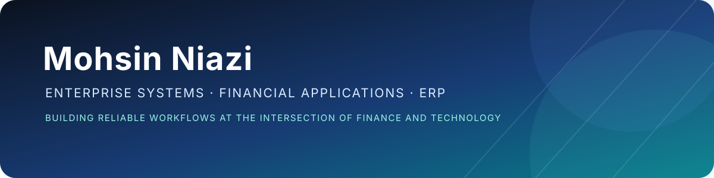

  

<h1 align="center">Hi, I’m Mohsin 👋</h1>

  <strong>Enterprise Systems &amp; Financial Applications Specialist</strong> 
  Oracle OPERA PMS · ERP · Finance Automation

  <a href="https://www.linkedin.com/in/mohsin-niazi/">LinkedIn</a>
  &nbsp;•&nbsp; Computational Finance
  &nbsp;•&nbsp; Open to building useful business software

---

## About

I work where **finance, operations, and technology** meet. My experience includes enterprise application support, multi-property systems administration, financial workflows, integrations, reporting, and user enablement.

I enjoy turning operational problems into dependable processes and practical software—especially tools that improve financial accuracy, reduce manual work, and make information easier to use.

## What I work with

- **Enterprise systems:** Oracle OPERA PMS, ERP and financial applications
- **Data and reporting:** SQL, Oracle PL/SQL, Power BI
- **Development and automation:** Python, C#/.NET, workflow automation
- **Integrations:** API-connected business systems and data exchange
- **Operations:** application support, implementation coordination, documentation, and end-user training

  
  
  
  
  

## Selected work

### LedgerLens
A local-first browser tool that checks finance CSVs for duplicate references, missing fields, invalid dates, and unreadable amounts. It exports a findings report without uploading the source file.

[Try LedgerLens](https://mohsin-niazi.github.io/ledgerlens/) · [View the source](https://github.com/mohsin-niazi/ledgerlens)

### Invoice ERP
A bilingual desktop ERP project built with C#/.NET, covering invoices, quotations, products, customers, expenses, payables, reporting, and PDF output.

### Payment reconciliation
Designing a finance workflow to compare payment records across systems, identify mismatches, and make exceptions easier to investigate.

## Currently learning

Deepening my Oracle SQL and PL/SQL skills while building useful finance and ERP tools.

## Connect

- **LinkedIn:** [mohsin-niazi](https://www.linkedin.com/in/mohsin-niazi/)

  Thanks for visiting — I’m always interested in practical ideas at the intersection of finance and technology.

